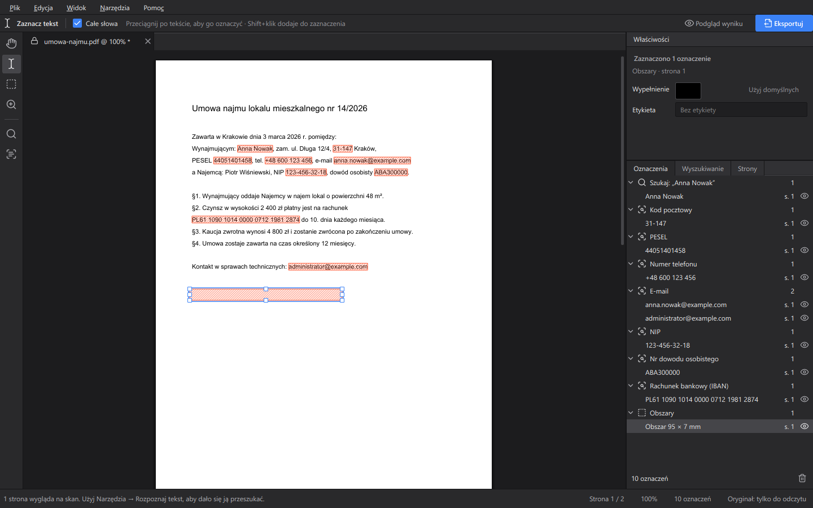
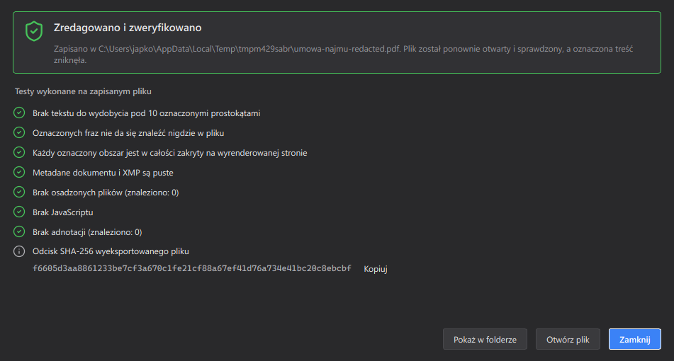

# Redactor

**Trwała, weryfikowalna redakcja PDF na Windows, macOS i Linux.**
*Permanent, verifiable PDF redaction for Windows, macOS and Linux — [English below](#english).*



Redactor usuwa zaznaczone dane z pliku PDF tak, że nie da się ich odzyskać. Nie zakrywa ich tylko czarnym prostokątem. Tekst pod oznaczeniem zostaje fizycznie skasowany, piksele skanów zamazane, a metadane, załączniki, JavaScript i ukryte warstwy usunięte. Po zapisie program otwiera wynik ponownie i pokazuje raport, który to potwierdza.

## Jak to działa

1. **Otwórz PDF.** Oryginał jest wczytywany tylko do odczytu i nigdy nie jest nadpisywany.
2. **Oznacz to, co ma zniknąć**, narzędziem z paska po lewej:
   | Narzędzie | Klawisz | Do czego |
   |---|---|---|
   | Zaznacz tekst | `T` | przeciągnij po tekście jak w czytniku PDF |
   | Prostokąt | `R` | dowolny obszar: podpis, zdjęcie, pieczątka, fragment skanu |
   | Wyszukiwanie i wzorce | `S` | fraza, wyrażenie regularne albo dane: PESEL, NIP, REGON, IBAN, karta płatnicza, nr dowodu, e-mail, telefon, kod pocztowy (z kontrolą sum kontrolnych) |
   | Rozpoznaj tekst (OCR) | `O` | skany stają się przeszukiwalne i można je zaznaczać (polski + angielski, bez instalowania Tesseracta) |
   | Rączka / Lupa | `H` / `Z` | nawigacja; Spacja to chwilowa rączka w każdym narzędziu |
3. **Przejrzyj trafienia klawiaturą:** `Enter` oznacza, `Delete` pomija, strzałki przechodzą do następnego.
4. **Eksportuj** (`Ctrl+Shift+E`). Widzisz podgląd przed/po wygenerowany tym samym procesem co eksport. Opcjonalnie możesz **spłaszczyć strony do obrazów**, wtedy w pliku nie zostaje żaden tekst.
5. **Raport weryfikacji.** Zapisany plik jest ponownie otwierany i sprawdzany: czy pod oznaczeniami nie ma tekstu, czy oznaczonych fraz nie da się znaleźć, czy obszary są zakryte na wyrenderowanej stronie, czy metadane i XMP są puste, czy nie ma osadzonych plików, JavaScriptu ani adnotacji. Dostajesz też odcisk SHA-256 pliku.



Pracę można zapisać jako projekt `*.redactor.json`. Domyślnie projekt **nie zawiera** treści oznaczonych fragmentów, tylko ich położenie. Cofanie i ponawianie działa przez `Ctrl+Z` / `Ctrl+Y`, a pełna lista skrótów jest pod `F1`.

## Instalacja

Gotowe instalatory są w zakładce **Releases**: `.exe` (Windows), `.dmg` (macOS) i `.AppImage` (Linux). Dane OCR są dołączone.

### Ze źródeł

Wymagany jest [uv](https://docs.astral.sh/uv/).

```sh
uv sync
uv run python scripts/fetch_tessdata.py   # dane OCR (pol + eng), ok. 9 MB
uv run redactor                           # albo: uv run python -m redactor plik.pdf
```

## Dla deweloperów

```sh
uv run pytest                             # testy rdzenia, wzorców, i18n i UI
uv run ruff check src tests scripts
uv run python scripts/check_translations.py
uv run python scripts/screenshots.py      # zrzuty ekranu do .impeccable/review/
uv run redactor --self-test               # test redakcji + OCR (także w zbudowanej paczce)
```

**Tłumaczenia** są w `src/redactor/i18n/{en,pl}.json` (płaskie klucze, posortowane). W kodzie używa się `tr("klucz")`, `tr_n("klucz", n)` dla liczby mnogiej (polski ma formy `one`/`few`/`many`) oraz `N_("klucz")` dla kluczy przechowywanych w danych. `scripts/check_translations.py` zgłasza brakujące, puste i nadmiarowe klucze, niezgodne `{placeholdery}`, niepełne formy liczby mnogiej oraz klucze użyte w kodzie, a nieobecne w plikach. To samo sprawdzają testy i CI. Zmienna `REDACTOR_I18N_DEBUG=1` pokazuje w interfejsie surowe klucze zamiast tekstów.

**Budowanie paczek** odbywa się w GitHub Actions (`.github/workflows/release.yml`) po wypchnięciu taga `v*`: PyInstaller, potem Inno Setup, `hdiutil` albo `appimagetool`. Lokalnie:

```sh
uv run pyinstaller packaging/redactor.spec --noconfirm   # dist/Redactor/
```

### Architektura

```
src/redactor/core/   document (model tekstu znak po znaku), patterns, textops,
                     redaction (redakcja + scrub + spłaszczenie), verify, project, ocr
src/redactor/ui/     main_window, canvas (płótno i narzędzia), panels, export_dialog,
                     session (oznaczenia + undo), theme (tokeny, QSS, ikony)
```

Redakcja korzysta z PyMuPDF: `add_redact_annot` → `apply_redactions` (tekst usuwany znak po znaku, piksele obrazów zamazywane, grafika wektorowa usuwana) → `scrub` → pełny zapis z `garbage=4`, który usuwa osierocone obiekty. Tekst jest normalizowany (twarde spacje, miękkie dywizy, ligatury), żeby wyszukiwanie nie pomijało danych zapisanych typograficznymi wariantami znaków.

### Ograniczenia

- Etykieta w ramce (np. `[REDACTED]`) obsługuje tylko podstawowe znaki łacińskie.
- Pliki chronione hasłem trzeba najpierw odblokować w innym programie.
- Jeśli obraz jest współdzielony przez kilka stron, zamazanie dotyczy tylko strony z oznaczeniem. Na pozostałych stronach obraz jest widoczny tak jak wcześniej.

## Licencja

GNU AGPL v3 lub nowsza (wymóg PyMuPDF), zob. [LICENSE](LICENSE). Ikony: [Lucide](https://lucide.dev) (ISC). Dane OCR: [tessdata_fast](https://github.com/tesseract-ocr/tessdata_fast) (Apache 2.0).

Projekt zastępuje [pdf-redact-tools](https://github.com/firstlookmedia/pdf-redact-tools), które nie jest już rozwijane. Pomysł spłaszczania stron do obrazów pochodzi stamtąd.

---

## English

Redactor permanently removes marked content from PDF files. Text under a mark is deleted glyph by glyph, scanned pixels are blanked, and metadata, XMP, attachments, embedded files, JavaScript, links and hidden text are scrubbed. The original file is never written to. After export, the output is reopened and verified, and you get a checklist report plus the file's SHA-256.

Marking tools: text selection (`T`), rectangle (`R`), phrase / regex / personal-data patterns with checksum validation (`S`), and built-in OCR for scans (`O`, Polish + English data bundled). Search hits are reviewed with the keyboard: `Enter` accepts, `Delete` skips. Optional flattening turns every page into an image, so no text object survives at all. The UI is available in English and Polish (*View → Language*), with dark and light themes.

Run from source with `uv sync && uv run python scripts/fetch_tessdata.py && uv run redactor`. Installers for Windows, macOS and Linux are built by GitHub Actions on `v*` tags. License: AGPL-3.0-or-later.
